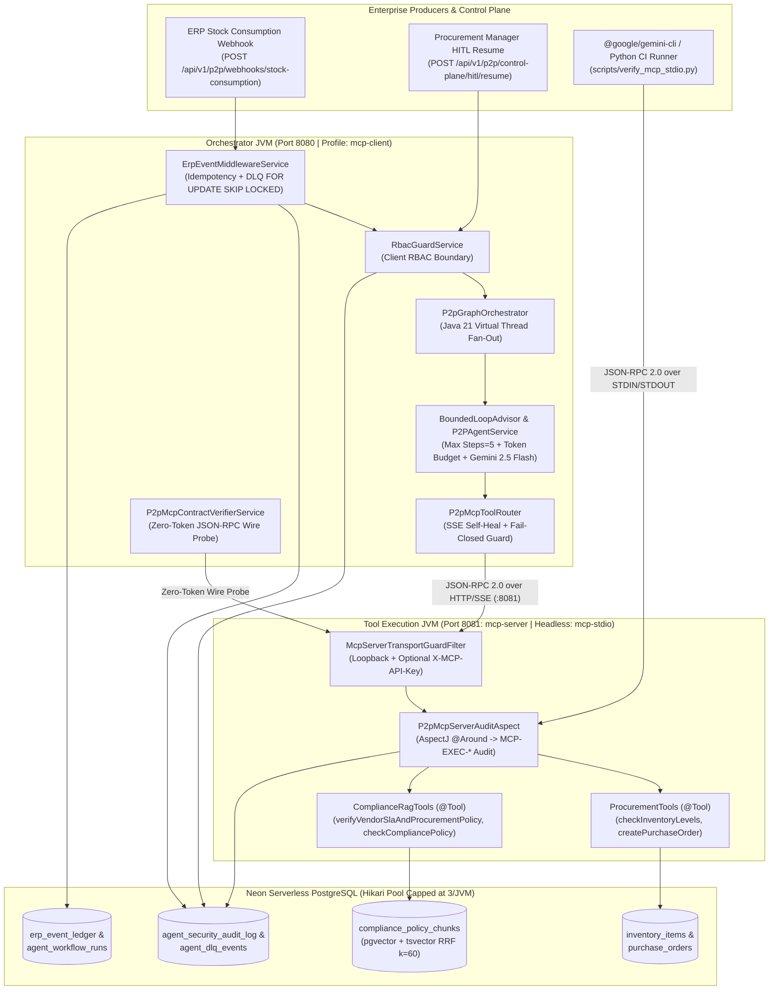

# Enterprise Procure-to-Pay (P2P) & Supply Chain Risk Agent (System 1)

**Production-Grade Agentic Microservice | Java 21 · Spring Boot 3.3 · Spring AI · Model Context Protocol (MCP) · Neon Serverless PostgreSQL (`pgvector` + `tsvector`)**

- **Release Milestones:**
    - `v1.0-phase2-complete` — Phase 2: Agentic DAG Orchestration, Transactional `@Tool` Execution, Hybrid RAG (`pgvector` + `tsvector` RRF + Cross-Encoder Reranking), Bounded Loop Guardrails, RBAC & HITL Lifecycle (`ADR-001` – `ADR-006`).
    - `v2.0.0` — Phase 3: Standalone Model Context Protocol (MCP) Server/Client Split (`:8081` SSE / `:8080` Client / Headless `mcp-stdio`), Cross-JVM AspectJ Security Auditing, and Zero-Token Wire Contract Verification (`ADR-007` – `ADR-010`).

---

## 1. Executive Summary (BLUF)

Enterprise supply chains suffer from delayed stockout detection, manual vendor contract verification, and unguarded LLM tool execution risks. **System 1** is an autonomous, event-driven **Procure-to-Pay (P2P) & Supply Chain Risk Agent** engineered for high-reliability enterprise environments:

- **Deterministic Financial Guardrails:** Automatically executes restock purchase orders under **₹50,000** while hard-pausing orders above **₹50,000** in `PENDING_MANAGER_APPROVAL` for Human-in-the-Loop (HITL) manager sign-off (`ADR-001`, `ADR-006`).
- **Hybrid RAG + Cross-Encoder Reranking:** Combines `pgvector` dense embeddings with PostgreSQL `tsvector` BM25 keyword search via **Reciprocal Rank Fusion (RRF, k=60)** and Cross-Encoder reranking over vendor SLA contracts and procurement policies (`ADR-002`).
- **Bounded Loop & Graph Orchestration:** Replaces open-ended ReAct loops with a deterministic DAG (`P2pGraphOrchestrator`) using Java 21 Virtual Threads for parallel pre-check fan-out, step-count circuit breakers (`maxStepsAllowed: 5`), and token budget enforcement (`ADR-003`, `ADR-004`).
- **Zero-Trust Model Context Protocol (MCP) Topology:** Decouples the Agent Orchestrator (`mcp-client` on `:8080`) from the Database/Tool Execution boundary (`mcp-server` on `:8081` over HTTP/SSE and headless `mcp-stdio`), enforcing cross-JVM AspectJ RBAC auditing (`MCP-EXEC-*`) and automatic fail-closed Dead-Letter Queue (`agent_dlq_events`) routing (`ADR-007` – `ADR-010`).

---

## 2. System Architecture & Cross-JVM MCP Topology



---

## 3. Empirical Latency, Token Economics & Wire Benchmarks

Measured against live **Neon Serverless PostgreSQL** and **Google AI Studio (`gemini-2.5-flash`)** on a 12 GB RAM dual-JVM setup (`HikariCP max-pool-size=3` per JVM):

| Operation / Execution Path | Transport / Mode | LLM Tokens Used | Empirical Latency | Reliability / Guardrail Behavior |
|---|---|---:|---:|---|
| **MCP Bridge Health Probe** (`/mcp-bridge-status`) | HTTP/SSE `tools/list` | `0` | `~45 – 110 ms` | Detects `:8081` restart & self-heals SSE client |
| **Wire Probe: `checkInventoryLevels`** | JSON-RPC `tools/call` (`:8080` → `:8081`) | `0` | `~754 ms` | Writes `MCP-EXEC-*` `ALLOWED` audit row |
| **Wire Probe: `verifyVendorSlaAndProcurementPolicy`** | JSON-RPC `tools/call` (`pgvector` + `tsvector` RRF + Rerank) | `0` | `~2,171 ms` | Hybrid RRF (`k=60`) + Cross-Encoder scoring |
| **Full E2E Agentic Restock Loop** (`SKU-TITANIUM-VALVE-99`) | Virtual-Thread Pre-Check + Remote MCP Tool Call | `3 / 5 steps` | `~4.8 – 6.4 s` | Pauses ₹62,500 PO in `PENDING_MANAGER_APPROVAL` |
| **Chaos Fail-Closed Routing** (`:8081` Unreachable) | Fast-Fail Circuit Breaker | `0` | `< 50 ms` | Persists webhook payload to `agent_dlq_events` (`PENDING_REPLAY`) |

---

## 4. Verified End-to-End Correlated Execution Trace

Full sample artifact: [`docs/sample/correlated-execution-trace-sample `](docs/sample/correlated-execution-trace-sample.json)

Calling `GET /api/v1/p2p/control-plane/trace/BATCH-2026-10-24-E2E-001` joins `erp_event_ledger`, `agent_workflow_runs`, `purchase_orders`, `api_cost_logs`, and `agent_security_audit_log` into a single deterministic audit trail:

```json
{
  "idempotencyKey": "BATCH-2026-10-24-E2E-001",
  "erpLedgerStatus": "AGENT_TRIGGERED",
  "workflowRunStatus": "COMPLETED_AFTER_HITL",
  "sku": "SKU-TITANIUM-VALVE-99",
  "poId": "9e283f58-4099-4f57-9991-8f518d0d2804",
  "poTotalAmountInr": 62500,
  "poStatus": "APPROVED",
  "poCreatedAt": "2026-10-29T06:11:22.83883Z",
  "hitlResolvedAt": "2026-10-31T06:04:58.158706Z",
  "hitlResolvedBy": "mgr-procurement-01",
  "finalAgentResponse": "[resolved_at=2026-10-31T11:34:58.242716300+05:30] HITL APPROVE by mgr-procurement-01: PO 9e283f58-4099-4f57-9991-8f518d0d2804 for SKU SKU-TITANIUM-VALVE-99 (INR 62500.00) successfully APPROVED by mgr-procurement-01. Downstream ERP dispatch initiated. | Reason: Verified titanium valve stockout and vendor SLA compliance POL-PROC-2026-09.",
  "tokenEconomics": {
    "totalStepCount": 3,
    "maxStepsAllowed": 5,
    "workflowTotalTokens": 0,
    "loggedInputTokens": 0,
    "loggedOutputTokens": 0,
    "estimatedCostInr": 0
  },
  "securityAuditTrail": [
    {
      "id": 74,
      "correlationId": "PO-SKU-TITANIUM-VALVE-99-VEND-TATA-IND-25-2d87e872",
      "actorId": "mgr-procurement-01",
      "actorRole": "ROLE_PROCUREMENT_MANAGER",
      "actionName": "HITL_WORKFLOW_RESUME",
      "targetResource": "PO:9e283f58-4099-4f57-9991-8f518d0d2804",
      "decision": "ALLOWED",
      "reason": "Authorized via role ROLE_PROCUREMENT_MANAGER",
      "createdAt": "2026-10-31T06:04:58.158706Z"
    },
    {
      "id": 77,
      "correlationId": "PO-SKU-TITANIUM-VALVE-99-VEND-TATA-IND-25-2d87e872",
      "actorId": "mgr-procurement-01",
      "actorRole": "ROLE_PROCUREMENT_MANAGER",
      "actionName": "VIEW_CORRELATED_AUDIT_TRACE",
      "targetResource": "RUN:PO-SKU-TITANIUM-VALVE-99-VEND-TATA-IND-25-2d87e872",
      "decision": "ALLOWED",
      "reason": "Authorized via role ROLE_PROCUREMENT_MANAGER",
      "createdAt": "2026-10-31T06:10:44.736111Z"
    }
  ]
}
```

---

## 5. Architecture Decision Records (ADR Index)

All architectural trade-offs are documented in `docs/adr/`:

| ADR | Title | Core Decision & Guardrail Enforced |
|---|---|---|
| **ADR-001** | Transactional `@Tool` Design & Deterministic HITL Gate | Calculate authoritative PO pricing inside PostgreSQL; route POs above ₹50,000 to `PENDING_MANAGER_APPROVAL`; exclude `confirmHighValuePurchaseOrder` from LLM tool surface. |
| **ADR-002** | Hybrid Search (`pgvector` + `tsvector` RRF) & Cross-Encoder Reranking | Combine semantic dense retrieval with exact clause/SKU keyword matching via Reciprocal Rank Fusion (`k=60`) and deterministic reranking. |
| **ADR-003** | Bounded Loop Engineering & Cost Telemetry | Enforce hard step limits (`maxSteps=5`), token budgets, and per-call cost logging in `api_cost_logs` via `BoundedLoopAdvisor`. |
| **ADR-004** | Deterministic DAG Orchestration & Virtual-Thread Fan-Out | Pre-compute inventory deficit and vendor SLA compliance concurrently on Java 21 Virtual Threads before invoking Gemini for transactional PO execution. |
| **ADR-005** | Deterministic RBAC, Webhook Idempotency & DLQ Replay | Enforce pre-execution RBAC (`agent_security_audit_log`), `batch_id` idempotency, and concurrent-safe `FOR UPDATE SKIP LOCKED` DLQ replay. |
| **ADR-006** | HITL Lifecycle Coordinator & Unified Correlated Audit Trace | Synchronize state transitions across `purchase_orders`, `agent_workflow_runs`, and `erp_event_ledger` on manager approval/rejection. |
| **ADR-007** | Multi-Profile MCP Server/Client Split & SSE Self-Healing | Extract `@Tool` beans into `:8081` (`mcp-server`), cap HikariCP pools at 3 per JVM for 12 GB RAM hosts, and auto-heal stale SSE transports in `P2pMcpToolRouter`. |
| **ADR-008** | Zero-Trust MCP Server Audit Aspect & Loopback Transport Filter | Intercept every remote tool invocation on `:8081` via AspectJ `@Around` (`P2pMcpServerAuditAspect`) and restrict `/sse` & `/mcp/message` to trusted loopback origins. |
| **ADR-009** | Zero-Token MCP Wire Contract Verifier & Telemetry Endpoint | Programmatically verify schema parity across the 4 exposed tools, assert HITL approval tool exclusion, and benchmark live JSON-RPC round-trip latency with zero LLM token burn. |
| **ADR-010** | Headless `mcp-stdio` Subprocess Transport & Strict STDOUT Framing | Configure zero-banner, file-routed logging (`./logs/mcp-stdio-server.log`) for clean newline-delimited JSON-RPC 2.0 execution under `@google/gemini-cli` and CI harnesses. |

---

## 6. Local Execution Runbook (12 GB RAM Optimized)

### Mode A: Dual-JVM HTTP/SSE Production Topology (`:8081` + `:8080`)
```bash
# Terminal 1: Start Isolated MCP Server on Port 8081
mvn spring-boot:run -Dspring-boot.run.profiles=mcp-server \
  -Dspring-boot.run.jvmArguments="-Xms256m -Xmx512m"

# Terminal 2: Start P2P Agent Orchestrator (MCP Client) on Port 8080
mvn spring-boot:run -Dspring-boot.run.profiles=mcp-client \
  -Dspring-boot.run.jvmArguments="-Xms256m -Xmx512m"

# Terminal 3: Run Zero-Token Wire Contract & Audit Verification
curl -X POST "http://localhost:8080/api/v1/p2p/control-plane/mcp-contract/verify" \
  -H "X-Actor-Id: sec-auditor-01" \
  -H "X-Actor-Role: ROLE_PROCUREMENT_MANAGER"
```

### Mode B: Headless STDIO Subprocess Harness (`mcp-stdio`)
```bash
# Build executable JAR
mvn clean package -DskipTests

# Run Automated Python JSON-RPC 2.0 STDIO Verification Harness
python scripts/verify_mcp_stdio.py
```