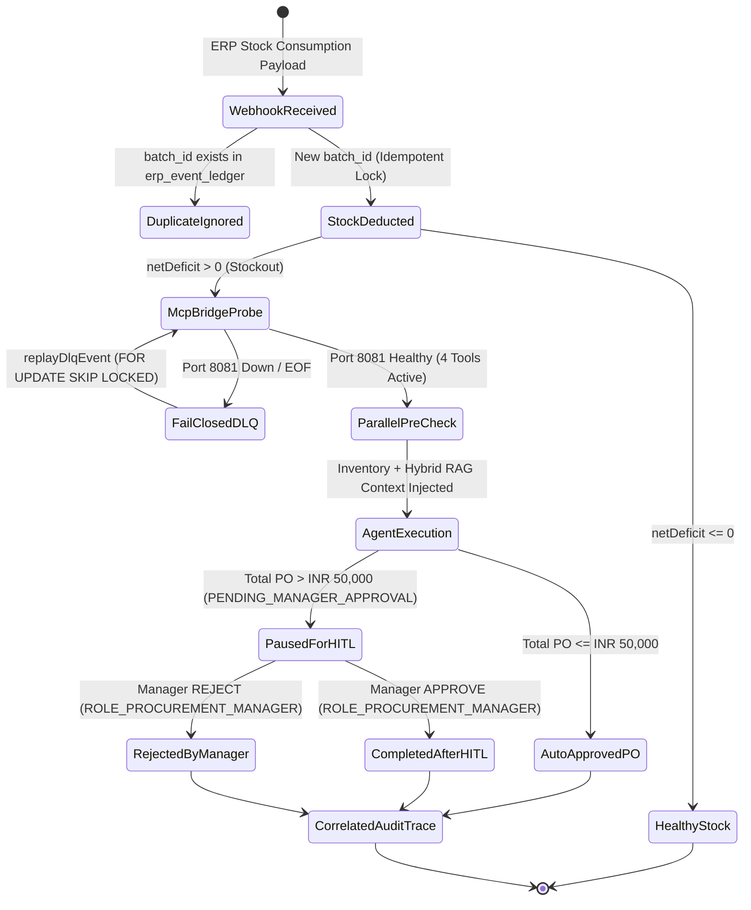

# System 1: Enterprise Procure-to-Pay (P2P) & Supply Chain Risk Agent

> **BLUF (Bottom Line Up Front):** A production-grade, event-driven Agentic AI microservice built with **Java 21, Spring Boot 3.x, Spring AI, Model Context Protocol (MCP), and Neon Serverless PostgreSQL (`pgvector` + `tsvector`)**. It automates stockout detection, hybrid-RAG vendor SLA compliance verification, and transactional Purchase Order (PO) generation with a **deterministic ₹50,000 Human-in-the-Loop (HITL) approval gate**, **Two-Hop Cross-JVM RBAC auditing**, **self-healing SSE transport**, and a **fail-closed Dead Letter Queue (DLQ)**.

---

## 1. Executive Architecture & Capability Highlights

| Capability Dimension | Production Implementation in This Repository | Architectural Guarantee |
| :--- | :--- | :--- |
| **Agentic Graph Orchestration** (`ADR-004`) | `P2pGraphOrchestrator` + Java 21 Virtual Threads fan-out pre-checks (`checkInventoryLevels` + `checkCompliancePolicy`) | Deterministic `BigDecimal` net-deficit calculation (physical stock + in-flight POs) before LLM synthesis. |
| **Hybrid RAG + Reranking** (`ADR-002`) | `ComplianceRagTools` combining `pgvector` dense embeddings + PostgreSQL `tsvector` BM25 via **Reciprocal Rank Fusion (RRF, k=60)** + Cross-Encoder Reranking | Prevents policy hallucination on vendor penalty clauses and split-PO prohibitions (`POL-PROC-2026-09`). |
| **Deterministic HITL Gate** (`ADR-001`, `ADR-006`) | POs $\le$ ₹50,000 auto-approve; POs $>$ ₹50,000 transition to `PENDING_MANAGER_APPROVAL` and pause workflow state | Structural capability isolation: `confirmHighValuePurchaseOrder` is **excluded from the MCP Server**, making LLM self-approval impossible even under prompt injection. |
| **Dual-Profile MCP Topology** (`ADR-007`, `ADR-010`) | Standalone MCP Server (`:8081` HTTP/SSE & headless `mcp-stdio`) consumed by MCP Client Orchestrator (`:8080`) via `P2pMcpToolRouter` | Zero domain code duplication (`MethodToolCallbackProvider`); auto-heals broken SSE pipes on `:8081` restart; fails closed to `agent_dlq_events` when unreachable. |
| **Two-Hop Zero-Trust RBAC & AspectJ Audit** (`ADR-005`, `ADR-008`) | Client-side `RbacGuardService` (`:8080`) + Server-side `P2pMcpServerAuditAspect` (`@Around` on `:8081`) + `McpServerTransportGuardFilter` | Every remote MCP tool call writes an immutable `MCP-EXEC-*` authorization record to `agent_security_audit_log` before SQL execution. |
| **Zero-Token MCP Wire Verifier** (`ADR-009`) | `P2pMcpContractVerifierService` invokes remote `ToolCallback` instances directly over JSON-RPC without calling Gemini | Isolates pure MCP wire + DB latency from LLM inference latency at **₹0.00 token cost**. |

---

## 2. System Topology & Execution Flow

### 2.1 Dual-JVM MCP Client/Server & Headless STDIO Architecture (`ADR-007` – `ADR-010`)

```mermaid
flowchart TB
    subgraph External["External Enterprise Triggers & Operators"]
        ERP["ERP Stock Webhook\n(ROLE_ERP_WEBHOOK)"]
        MGR["Procurement Manager\n(ROLE_PROCUREMENT_MANAGER)"]
        OPS["Ops / CI Verifier\n(ROLE_SUPPLY_CHAIN_OPERATOR)"]
        CLI["@google/gemini-cli / Claude\n(Subprocess Host)"]
    end

    subgraph ClientJVM["Orchestrator & Control Plane JVM (Port 8080 | Profile: mcp-client)"]
        MW["ErpEventMiddlewareService\n(Batch Idempotency + DLQ Routing)"]
        ORCH["P2pGraphOrchestrator\n(Virtual-Thread Fan-Out + Pre-Checks)"]
        ROUTER["P2pMcpToolRouter\n(Self-Healing SSE Client + Fail-Closed Guard)"]
        AGENT["P2PAgentService\n(Gemini 2.5 Flash + BoundedLoopAdvisor)"]
        CTRL["P2pLifecycleCoordinatorService\n(HITL Resume + Correlated Trace + DLQ Sweep)"]
        CONTRACT["P2pMcpContractVerifierService\n(Zero-Token JSON-RPC Wire Verifier)"]
        RBAC_C["RbacGuardService (Hop 1 Audit)"]
    end

    subgraph ServerJVM["Isolated MCP Server JVM (Port 8081: mcp-server | Headless: mcp-stdio)"]
        FILTER["McpServerTransportGuardFilter\n(Loopback IP + Optional X-MCP-API-Key)"]
        ASPECT["P2pMcpServerAuditAspect\n(Hop 2 AspectJ @Around RBAC Audit)"]
        PROC_TOOLS["ProcurementTools (@Tool)\n- checkInventoryLevels\n- createPurchaseOrder"]
        RAG_TOOLS["ComplianceRagTools (@Tool)\n- checkCompliancePolicy\n- verifyVendorSlaAndProcurementPolicy"]
    end

    subgraph Storage["Neon Serverless PostgreSQL (Hikari Pool Capped at 3 per JVM)"]
        DB_INV[("inventory_items\npurchase_orders\nerp_event_ledger")]
        DB_VEC[("compliance_policy_chunks\n(pgvector + tsvector RRF k=60)")]
        DB_AUD[("agent_security_audit_log\nagent_workflow_runs\nagent_dlq_events")]
    end

    ERP -->|POST /webhook/consumption| MW
    MW --> RBAC_C
    MW -->|Stockout Detected| ORCH
    ORCH --> ROUTER
    ORCH --> AGENT
    AGENT -->|Remote ToolCallback| ROUTER
    MGR -->|POST /hitl/resume\nGET /traces/{key}| CTRL
    CTRL --> RBAC_C
    OPS -->|POST /mcp-contract/verify| CONTRACT
    CONTRACT -->|Zero-LLM-Token Probe| ROUTER

    ROUTER ==>|HTTP/SSE JSON-RPC\nGET /sse & POST /mcp/message| FILTER
    CLI -.->|STDIN / STDOUT JSON-RPC\n(Profile: mcp-stdio)| ASPECT
    FILTER --> ASPECT
    ASPECT --> PROC_TOOLS
    ASPECT --> RAG_TOOLS
    ASPECT -->|INSERT MCP-EXEC-*| DB_AUD
    PROC_TOOLS --> DB_INV
    RAG_TOOLS --> DB_VEC
    CTRL --> DB_INV
    CTRL --> DB_AUD
```

### 2.2 Deterministic HITL Approval & Fail-Closed DLQ State Machine (`ADR-003` – `ADR-006`)



---

## 3. Empirical Split-Latency & Production Benchmarks

Captured on **12 GB RAM Workstation + Neon Serverless PostgreSQL (ap-southeast-1)** using `POST /api/v1/p2p/control-plane/mcp-contract/verify` (`ADR-009`):

| Execution Path / Layer | Measured Latency (ms) | LLM Tokens Used | Security Audit Rows Written | Notes |
| :--- | :---: | :---: | :---: | :--- |
| **MCP Bridge Health Handshake** (`listTools()`) | `85 – 140 ms` | `0` | `0` | Probes `:8081` SSE readiness (`registeredToolCount: 4`). |
| **Remote SQL Tool over MCP** (`checkInventoryLevels`) | `754 ms` | `0` | `2` (`MCP-CONTRACT-*` + `MCP-EXEC-*`) | Includes JSON-RPC wire serialization, AspectJ RBAC audit `INSERT`, and Neon DB stock + in-flight PO calculation. |
| **Remote Hybrid RAG + Cross-Encoder over MCP** (`verifyVendorSlaAndProcurementPolicy`) | `2,171 ms` | `0` | `2` (`MCP-CONTRACT-*` + `MCP-EXEC-*`) | Includes embedding generation, `pgvector` + `tsvector` RRF (`k=60`) query, Cross-Encoder reranking, and AspectJ audit `INSERT`. |
| **Full Zero-Token Contract Verification Suite** (`/mcp-contract/verify`) | `4,558 ms` | `0` (`₹0.00`) | `3` (1 Client + 2 Server) | Verifies schema parity, runs both read-only wire probes, and asserts server audit persistence. |
| **Full E2E Agentic P2P Run** (Webhook $\rightarrow$ Gemini 2.5 Flash $\rightarrow$ Remote PO Creation) | `3,800 – 5,400 ms` | `~1,150 – 1,650` | `4+` | Bounded by `BoundedLoopAdvisor` (`maxStepsAllowed = 5`). |

---

## 4. Golden Correlated Execution Trace (`docs/sample/correlated-execution-trace-sample.json`)

Below is a real production trace retrieved via `GET /api/v1/p2p/control-plane/traces/BATCH-2026-10-24-E2E-001` after a **₹62,500** purchase order (`SKU-TITANIUM-VALVE-99`, 25 units @ ₹2,500/unit) was paused by the ₹50,000 HITL gate and subsequently approved by `mgr-procurement-01` (`ROLE_PROCUREMENT_MANAGER`):

```json
{
  "idempotencyKey": "BATCH-2026-10-24-E2E-001",
  "erpLedgerStatus": "AGENT_TRIGGERED",
  "workflowRunStatus": "COMPLETED_AFTER_HITL",
  "sku": "SKU-TITANIUM-VALVE-99",
  "poId": "9e283f58-4099-4f57-9991-8f518d0d2804",
  "poTotalAmountInr": 62500,
  "poStatus": "APPROVED",
  "poCreatedAt": "2026-10-29T06:11:22.83883Z",
  "hitlResolvedAt": "2026-10-31T06:04:58.158706Z",
  "hitlResolvedBy": "mgr-procurement-01",
  "finalAgentResponse": "[resolved_at=2026-10-31T11:34:58.242716300+05:30] HITL APPROVE by mgr-procurement-01: PO 9e283f58-4099-4f57-9991-8f518d0d2804 for SKU SKU-TITANIUM-VALVE-99 (INR 62500.00) successfully APPROVED by mgr-procurement-01. Downstream ERP dispatch initiated. | Reason: Verified titanium valve stockout and vendor SLA compliance POL-PROC-2026-09.",
  "tokenEconomics": {
    "totalStepCount": 3,
    "maxStepsAllowed": 5,
    "workflowTotalTokens": 0,
    "loggedInputTokens": 0,
    "loggedOutputTokens": 0,
    "estimatedCostInr": 0
  },
  "securityAuditTrail": [
    {
      "id": 74,
      "correlationId": "PO-SKU-TITANIUM-VALVE-99-VEND-TATA-IND-25-2d87e872",
      "actorId": "mgr-procurement-01",
      "actorRole": "ROLE_PROCUREMENT_MANAGER",
      "actionName": "HITL_WORKFLOW_RESUME",
      "targetResource": "PO:9e283f58-4099-4f57-9991-8f518d0d2804",
      "decision": "ALLOWED",
      "reason": "Authorized via role ROLE_PROCUREMENT_MANAGER",
      "createdAt": "2026-10-31T06:04:58.158706Z"
    },
    {
      "id": 77,
      "correlationId": "PO-SKU-TITANIUM-VALVE-99-VEND-TATA-IND-25-2d87e872",
      "actorId": "mgr-procurement-01",
      "actorRole": "ROLE_PROCUREMENT_MANAGER",
      "actionName": "VIEW_CORRELATED_AUDIT_TRACE",
      "targetResource": "RUN:PO-SKU-TITANIUM-VALVE-99-VEND-TATA-IND-25-2d87e872",
      "decision": "ALLOWED",
      "reason": "Authorized via role ROLE_PROCUREMENT_MANAGER",
      "createdAt": "2026-10-31T06:10:44.736111Z"
    }
  ]
}
```

---

## 5. Architecture Decision Records (ADR Index)

| ADR | Title | Key Architectural Trade-off & Decision |
| :--- | :--- | :--- |
| **`ADR-001`** | **Transactional `@Tool` Design & Deterministic ₹50k HITL Gate** | Calculate authoritative PO totals in SQL (`BigDecimal`) rather than trusting LLM arithmetic; enforce in-flight duplicate PO prevention and `PENDING_MANAGER_APPROVAL` for orders $>$ ₹50,000. |
| **`ADR-002`** | **Hybrid Search (`pgvector` + `tsvector` RRF k=60) & Cross-Encoder Reranking** | Combine dense vector search with exact keyword matching (`POL-PROC-2026-09`, SKU codes) in single PostgreSQL CTE, followed by Cross-Encoder top-k reranking. |
| **`ADR-003`** | **Loop Engineering: `BoundedLoopAdvisor` & Token Circuit Breakers** | Cap agent execution at `max_steps = 5` with strict token-budget logging (`api_cost_logs`) to prevent runaway agent loops. |
| **`ADR-004`** | **Graph Engineering: Virtual-Thread Fan-Out & Conditional Routing** | Run inventory triage and compliance policy retrieval concurrently on Java 21 virtual threads before invoking Gemini. |
| **`ADR-005`** | **Enterprise Middleware, Deterministic RBAC & DLQ Replay (`SKIP LOCKED`)** | Enforce `ROLE_ERP_WEBHOOK`, `ROLE_SUPPLY_CHAIN_OPERATOR`, and `ROLE_PROCUREMENT_MANAGER` via `RbacGuardService`; route failures to `agent_dlq_events` and replay safely using `FOR UPDATE SKIP LOCKED`. |
| **`ADR-006`** | **HITL Lifecycle Coordination & Non-Rollback Correlated Trace Auditing** | Synchronize `purchase_orders`, `agent_workflow_runs`, and `erp_event_ledger` on manager decision; return structured `TRACE_NOT_FOUND` instead of throwing unchecked exceptions so `@Transactional` audit logs never roll back. |
| **`ADR-007`** | **Dual-Profile MCP Server/Client Extraction & Self-Healing SSE Router** | Extract `@Tool` beans into `:8081` (`mcp-server`) with Hikari pool capped at 3; implement `P2pMcpToolRouter` on `:8080` (`mcp-client`) to auto-reconnect broken SSE pipes and fail closed to DLQ when `:8081` is down. |
| **`ADR-008`** | **Zero-Trust MCP Server AspectJ RBAC Audit & Loopback Transport Guard** | Intercept all remote `@Tool` executions on `:8081` via `P2pMcpServerAuditAspect` (`MCP-EXEC-*`) and restrict `/sse` + `/mcp/message` via `McpServerTransportGuardFilter`. |
| **`ADR-009`** | **Deterministic Zero-Token MCP Wire Contract & Split-Latency Verifier** | Invoke remote `ToolCallback` instances directly from `:8080` to verify schema parity, measure pure MCP wire + DB latency (`754 ms` / `2,171 ms`), and confirm server audit persistence at ₹0.00 LLM cost. |
| **`ADR-010`** | **Headless `mcp-stdio` Subprocess Harness & Strict `STDOUT` Framing** | Suppress Spring Boot banners and console logs in `mcp-stdio` mode so `@google/gemini-cli` and `scripts/verify_mcp_stdio.py` exchange clean newline-delimited JSON-RPC 2.0 frames over `STDIN`/`STDOUT`. |

---

## 6. Local Execution & Verification Guide (12 GB RAM Optimized)

### 6.1 Start Dual-JVM HTTP/SSE Mode (`:8081` + `:8080`)
```bash
# Terminal 1: Start Isolated MCP Server on Port 8081 (Hikari max-pool-size=3)
mvn spring-boot:run -Dspring-boot.run.profiles=mcp-server

# Terminal 2: Start P2P Orchestrator & Control Plane on Port 8080 (Hikari max-pool-size=3)
mvn spring-boot:run -Dspring-boot.run.profiles=mcp-client
```

### 6.2 Run Zero-Token MCP Contract & Split-Latency Verification
```bash
# 1. Probe MCP Bridge Readiness
curl -s http://localhost:8080/api/v1/p2p/control-plane/mcp-bridge-status | jq

# 2. Execute Zero-Token Wire Contract Probe (:8080 -> :8081 -> Neon DB)
curl -s -X POST "http://localhost:8080/api/v1/p2p/control-plane/mcp-contract/verify?sampleSku=SKU-TITANIUM-VALVE-99&sampleVendorId=VEND-TATA-IND" \
  -H "X-Actor-Id: ops-lead-01" \
  -H "X-Actor-Role: ROLE_SUPPLY_CHAIN_OPERATOR" | jq

# 3. Inspect Cross-Process MCP-EXEC-* Security Audit Telemetry
curl -s http://localhost:8080/api/v1/p2p/control-plane/mcp-contract/audit-telemetry \
  -H "X-Actor-Id: ops-lead-01" \
  -H "X-Actor-Role: ROLE_SUPPLY_CHAIN_OPERATOR" | jq
```

### 6.3 Run Headless `mcp-stdio` Subprocess Verification (`ADR-010`)
```bash
mvn clean package -DskipTests
python scripts/verify_mcp_stdio.py
```